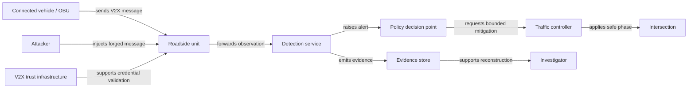

# UC1 entity-relationship view

The authoritative entity set is `models/instances/uc1_entities.json`; the
authoritative typed edges are `models/relationships/uc1_relationships.csv`.
`models/graph/uc1_graph.json` is their generated runtime projection and must not
be edited independently.

This is a readable projection, not a second source of truth. Cardinalities,
identifiers, trust boundaries, and provenance are specified in the canonical
JSON/CSV model and the mathematical model.
