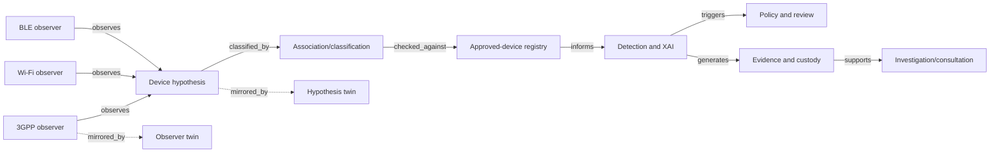

# UC2 entity-relationship view

This view is explanatory. The authoritative endpoints and relation types are `models/relationships/uc2_relationships.csv`; the validated deterministic projection is `models/graph/uc2_graph.json`.
